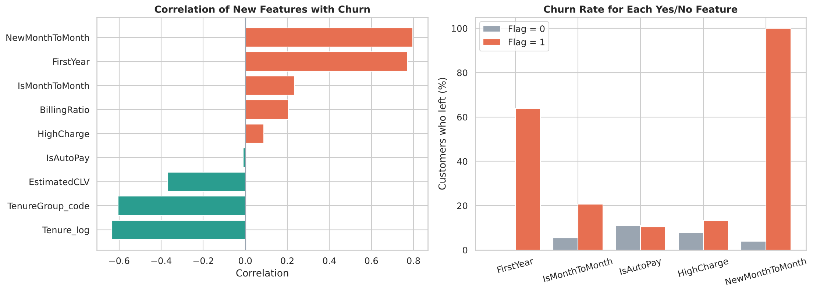
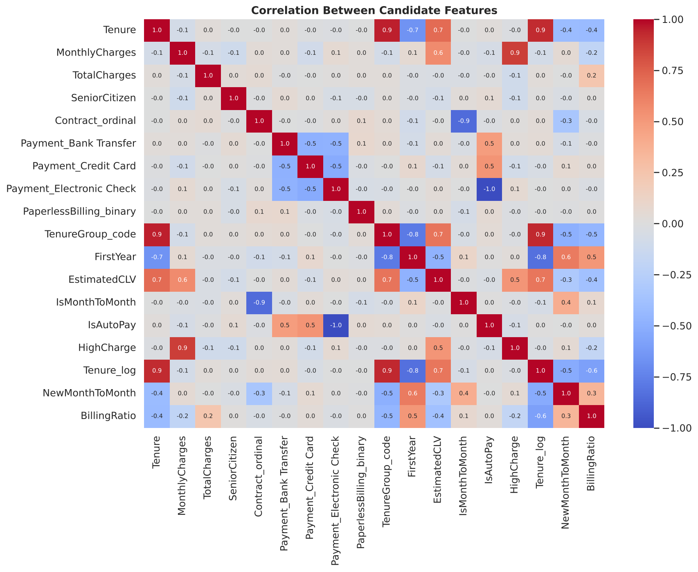
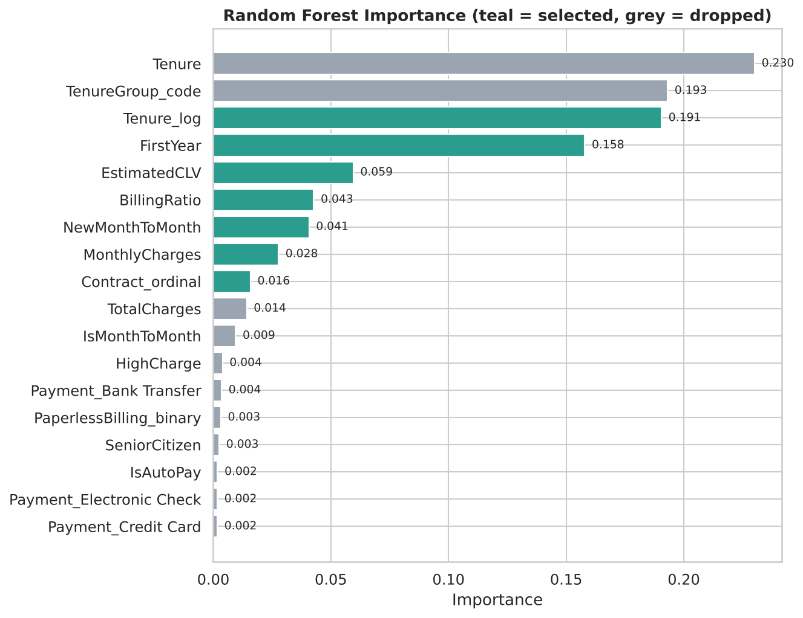
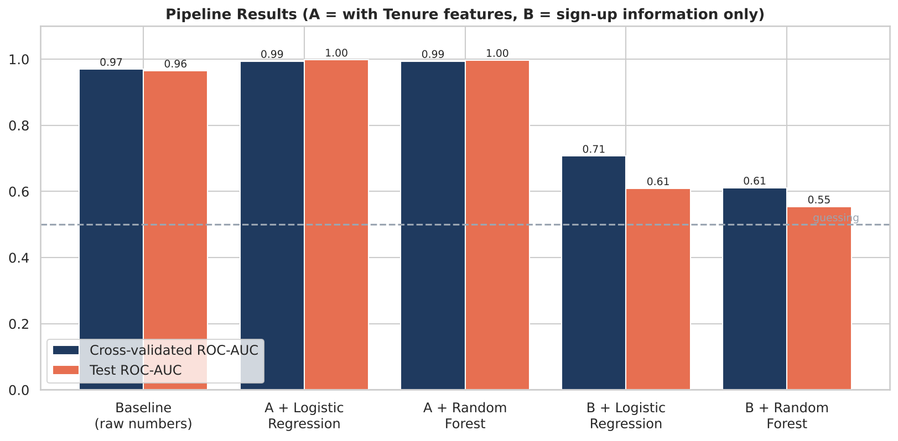

# Feature Engineering Documentation

Week 10 - Customer Churn Prediction

## 1. New features (9 created; the task needs 5 or more)

| Feature | How it is made | Why it could matter | Correlation with churn |
|---|---|---|---|
| TenureGroup_code | Tenure cut into 4 groups: 0-11, 12-23, 24-47, 48+ months (coded 0 to 3) | Customers behave differently at different stages | -0.605 |
| FirstYear | 1 if Tenure is 11 months or less | The first year is the risky period | 0.772 |
| EstimatedCLV | Tenure x MonthlyCharges | Revenue the customer has brought so far (customer lifetime value) | -0.368 |
| IsMonthToMonth | 1 if the contract is month-to-month | No commitment means an easy exit | 0.233 |
| IsAutoPay | 1 for Credit Card or Bank Transfer (assumed automatic) | Automatic payment may mean less friction | -0.010 |
| HighCharge | 1 if MonthlyCharges is above the training median | Expensive plans may push customers away | 0.087 |
| Tenure_log | log(1 + Tenure) | Reduces the effect of very long tenures | -0.634 |
| NewMonthToMonth | IsMonthToMonth x FirstYear (an interaction) | New customers with no commitment | 0.797 |
| BillingRatio | TotalCharges / EstimatedCLV (payment efficiency) | Checks if the billed total matches tenure and charges | 0.204 |

Techniques used: binning (TenureGroup_code), flags (FirstYear, IsMonthToMonth, IsAutoPay, HighCharge), combination of columns (EstimatedCLV, BillingRatio), transformation (Tenure_log) and an interaction (NewMonthToMonth). The HighCharge median comes from the training customers only.

## 2. Validation of the new features
Churn rate when the flag is 0 and when it is 1:

| Flag | 0 | 1 |
|---|---|---|
| FirstYear | 0.0% | 63.9% |
| IsMonthToMonth | 5.5% | 20.6% |
| IsAutoPay | 11.0% | 10.4% |
| HighCharge | 7.9% | 13.3% |
| NewMonthToMonth | 3.9% | 100.0% |

IsAutoPay shows almost no link with churn. BillingRatio has a median of 1.13 but a maximum of 208, which confirms the TotalCharges data problem.

## 3. Feature selection (4 methods)
Selection used the 400 training customers only, on 18 candidate features.

**Method 1: correlation analysis.** Pairs with correlation above 0.85 say the same thing:

| Pair | Correlation |
|---|---|
| Payment_Electronic Check and IsAutoPay | 1.00 (they are exact opposites) |
| Tenure and TenureGroup_code | 0.95 |
| TenureGroup_code and Tenure_log | 0.94 |
| Tenure and Tenure_log | 0.92 |
| MonthlyCharges and HighCharge | 0.87 |
| Contract_ordinal and IsMonthToMonth | 0.86 |

**Methods 2 to 4: F-test, mutual information and Random Forest importance** (top and bottom of the ranking):

| Feature | F-test p-value | Mutual information | Forest importance |
|---|---|---|---|
| Tenure_log | 0.0000 | 0.2433 | 0.1905 |
| Tenure | 0.0000 | 0.2364 | 0.2301 |
| TenureGroup_code | 0.0000 | 0.2240 | 0.1931 |
| FirstYear | 0.0000 | 0.2159 | 0.1579 |
| NewMonthToMonth | 0.0000 | 0.2035 | 0.0407 |
| EstimatedCLV | 0.0000 | 0.1404 | 0.0595 |
| BillingRatio | 0.0000 | 0.0876 | 0.0427 |
| Contract_ordinal | 0.0000 | 0.0513 | 0.0158 |
| MonthlyCharges | 0.0306 | 0.0039 | 0.0277 |
| TotalCharges | 0.7495 | 0.0000 | 0.0142 |
| PaperlessBilling_binary | 0.8782 | 0.0000 | 0.0032 |

**Selection rules:**
1. From each highly correlated pair, keep the feature with the better average rank across the three scores.
2. Drop a feature if the F-test finds no clear link (p above 0.05) and the forest gives it a weight below 0.02.

**Result:**
- Dropped as repeats: IsAutoPay, TenureGroup_code, Tenure, HighCharge, IsMonthToMonth.
- Dropped as having no link: TotalCharges, SeniorCitizen, Payment_Bank Transfer, Payment_Credit Card, Payment_Electronic Check, PaperlessBilling_binary.
- **Set A, 7 selected features:** Tenure_log, FirstYear, NewMonthToMonth, EstimatedCLV, BillingRatio, Contract_ordinal, MonthlyCharges.
- **Set B, 2 sign-up-only features:** Contract_ordinal, MonthlyCharges.

The three tenure features are nearly tied, so which one is kept can change between runs (the forest uses random numbers). They carry the same information.

## 4. Important warning: Tenure-based features
FirstYear, Tenure_log, EstimatedCLV, NewMonthToMonth and BillingRatio all come from Tenure. The longest tenure of any customer who left is 11 months, so these features look very strong (Set A cross-validated ROC-AUC 0.994). But Tenure may be the time a customer stayed before leaving, which partly gives away the answer. Using only sign-up information (Set B) the score falls to 0.71 (Logistic Regression) and 0.61 (Random Forest).

**Conclusion:** the new features help describe *who is at risk* (new customers on month-to-month contracts), but they should not be trusted as proof that churn can be predicted this sharply. To fix this the company should record when Tenure is measured for customers who leave, and predict from information available at the moment of prediction.

## 5. Where the features are built
All features are created by the `FeatureBuilder` step of the pipeline from the 7 raw columns, so a new customer can be scored from raw data only. See `preprocessing_report.md` for the full pipeline and the tests.
