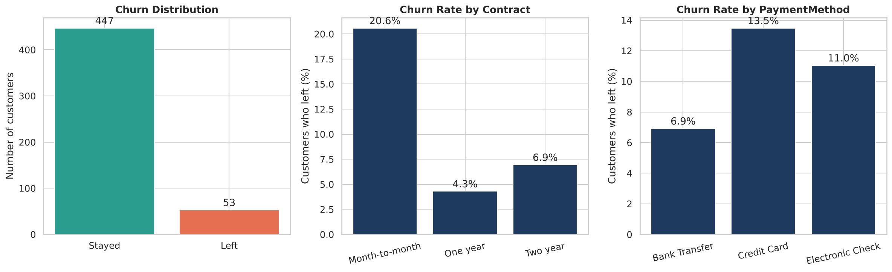
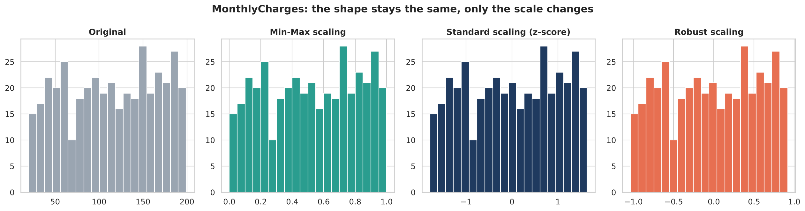
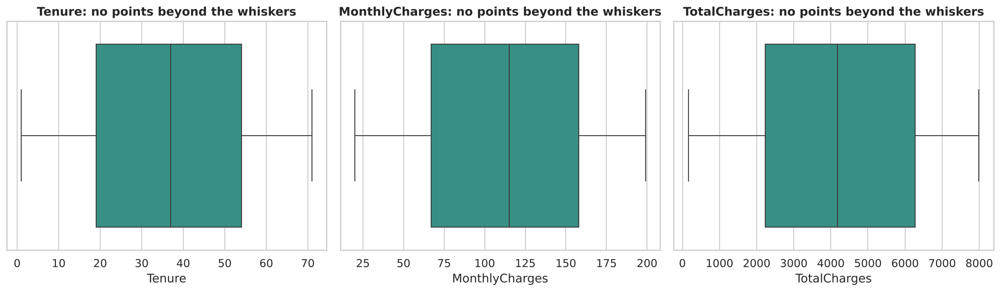
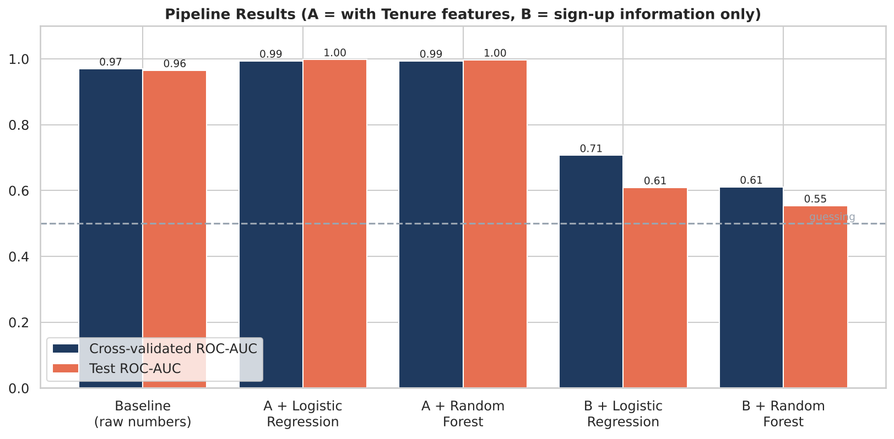

# Preprocessing Report: Customer Churn Prediction

Week 10 - Data Preprocessing and Feature Engineering

## 1. Goal
Prepare the customer data so a machine learning model can predict which customers will leave (churn), and build one repeatable pipeline that does all the preparation automatically. Every step below is explained with its reason.

## 2. The data
`churn_data.csv` has 500 customers and 9 columns: CustomerID, Tenure (months), MonthlyCharges, TotalCharges, Contract, PaymentMethod, PaperlessBilling, SeniorCitizen and Churn (1 = left).

| Check | Result |
|---|---|
| Missing values | 0 |
| Duplicate rows / duplicate customer IDs | 0 / 0 |
| Customers who stayed / left | 447 (89.4%) / 53 (10.6%) |
| Data types | 3 text columns (Contract, PaymentMethod, PaperlessBilling) plus CustomerID; the rest are numbers |

The data is **imbalanced**: far fewer customers left than stayed. Because of this, the models use balanced class weights and are judged with ROC-AUC, precision and recall, not accuracy alone. CustomerID is only a label, so it is not used as a feature.

Churn rate by category: Contract (month-to-month 20.6%, one year 4.3%, two year 6.9%), PaymentMethod (bank transfer 6.9%, credit card 13.5%, electronic check 11.0%), PaperlessBilling (no 10.1%, yes 11.1%), SeniorCitizen (no 11.2%, yes 10.0%).



**Data issue:** TotalCharges does not match Tenure x MonthlyCharges (the new BillingRatio feature has a median of 1.13 but a maximum of 208). It is kept for completeness but is not trusted.

## 3. Encoding categorical data (5 methods; the task needs 3)

| Method | Column | Result | Why |
|---|---|---|---|
| Label encoding | PaymentMethod | Bank Transfer 0, Credit Card 1, Electronic Check 2 | Shown for comparison. It creates a fake order, so it is only suitable for models that ignore order. |
| Ordinal encoding | Contract | Month-to-month 0, One year 1, Two year 2 | Contracts have a real order (a longer commitment). **Used in the pipeline.** |
| One-hot encoding | PaymentMethod | 3 columns of 0/1 | No order between payment methods, few categories. |
| Binary encoding | PaperlessBilling | Yes 1, No 0 | Only two categories. |
| Frequency encoding | PaymentMethod | Credit Card 0.356, Electronic Check 0.326, Bank Transfer 0.318 | Useful when a column has many categories (shown for completeness). |

After encoding there are 16 columns.

## 4. Feature scaling (3 methods; the task needs 2)
The data was split first (400 training and 100 testing customers, `stratify` keeps the churn rate at 10.5% and 11.0%). **Each scaler learns only from the training customers**, then is applied to the test customers. Fitting on all the data would leak test information into training.

| MonthlyCharges (training) | Min | Max | Mean | Std |
|---|---|---|---|---|
| Original | 20.0 | 199.0 | 113.5 | 52.4 |
| Min-Max scaling | 0.000 | 1.000 | 0.522 | 0.292 |
| Standard scaling (z-score) | -1.788 | 1.635 | -0.000 | 1.001 |
| Robust scaling | -1.038 | 0.918 | -0.016 | 0.572 |



The shape of the data does not change, only the scale. **Standard scaling is used in the pipeline** because it is the usual default for logistic regression. Min-Max suits neural networks and distance-based models, Robust scaling suits data with outliers, and tree models do not need scaling.

## 5. Outliers
Two methods were used on Tenure, MonthlyCharges and TotalCharges: the **IQR rule** (beyond 1.5 x IQR from the quartiles) and the **Z-score** (absolute value above 3). Both found **0 outliers** in all three columns, so no real customer was removed.



**Test of the detectors:** two fake values (1500 and 900) were added to MonthlyCharges. The IQR method found 2 and the Z-score method found 2. Capping at the IQR limits (-68 to 294) reduced the largest value from 1500 to 294.

**Handling choice:** capping (winsorizing) is used instead of deleting, because it keeps the customer. Capping is a step inside the pipeline, with limits learned from the training data. The engineered BillingRatio column has a long tail (maximum 208), so the capper does act on it.

## 6. The pipeline
```
raw columns -> 1. build features -> 2. cap outliers (IQR) -> 3. scale (Standard) -> 4. model
```
1. `FeatureBuilder` creates all features from the 7 raw columns (including the encodings above).
2. `IQRCapper` limits extreme values in the continuous columns.
3. `StandardScaler` scales the continuous columns; yes/no flags pass through unchanged.
4. A model (Logistic Regression or Random Forest) predicts churn.

Every learned value (median charge, capping limits, scaling mean and spread) comes from training data only. The whole pipeline sits inside the cross-validation folds, so no information leaks between folds.

## 7. Results
Two feature sets were compared (selection is explained in `feature_engineering_documentation.md`). Set A is the 7 selected features. Set B is the 2 features known at sign-up (Contract and MonthlyCharges). The test set has 100 customers, 11 of whom left.

| Setup | CV ROC-AUC | Test ROC-AUC | Precision | Recall | F1 |
|---|---|---|---|---|---|
| Baseline: raw numbers only | 0.970 | 0.965 | 0.550 | 1.000 | 0.710 |
| Set A + Logistic Regression | 0.994 | 0.998 | 0.647 | 1.000 | 0.786 |
| Set A + Random Forest | 0.994 | 0.997 | 1.000 | 0.727 | 0.842 |
| Set B + Logistic Regression | 0.707 | 0.609 | 0.146 | 0.636 | 0.237 |
| Set B + Random Forest | 0.611 | 0.554 | 0.167 | 0.182 | 0.174 |



**How to read this:**
- Set A scores about 0.99, but this should be treated with caution. All 53 customers who left had a tenure of 11 months or less, and Tenure may be the time a customer stayed *before leaving*, which partly reveals the answer. A model should not use information it would not have when making a prediction.
- Even the baseline already contains Tenure and scores 0.970, so the engineered features add only a small gain (0.970 to 0.994).
- Set B is the fair estimate for predicting new customers. It reaches only 0.61 to 0.71, a modest signal, so this data does not support sharp predictions for individual new customers.
- With only 11 churners in the test set, test scores move easily; the cross-validated score is steadier.

## 8. Testing evidence (end-to-end tests of the Set A pipeline)

| Test | Result |
|---|---|
| 1. Predict from raw columns only | Works, no manual steps (3 probabilities returned) |
| 2. Processed data shape | 7 columns, 0 missing values |
| 3. Refit and predict again | Identical predictions (True): the pipeline is reproducible |
| 4. Three new customers | New month-to-month customer (3 months, 150): 99.7% chance of leaving; two-year customer (60 months): 0.2%; one-year customer (8 months): 61.5% |
| 5. Extreme MonthlyCharges of 5000 | Runs without error (capper limits the value) |
| Outlier detector test | 2 of 2 fake outliers found by both methods |

## 9. Limitations
- Small data: 500 customers and 53 churners.
- Tenure may reveal the outcome, so Set A scores are probably too optimistic.
- TotalCharges is unreliable and was not selected.
- IsAutoPay assumes that credit card and bank transfer are automatic payments; the data does not say so.

## 10. Setup instructions
1. Install the packages: `pip install -r requirements.txt`
2. Open `churn_prediction_pipeline.ipynb` in Google Colab or Jupyter.
3. Upload `churn_data.csv` (or `customer_churn.csv`) when the first cell asks for a file. The notebook looks for a file name that contains "churn" or "customer".
4. Run all cells from top to bottom.
